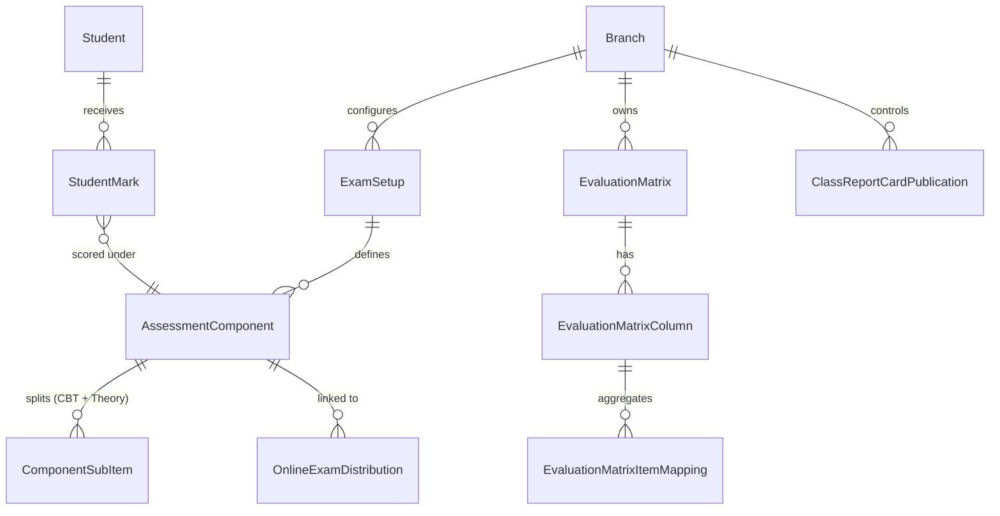
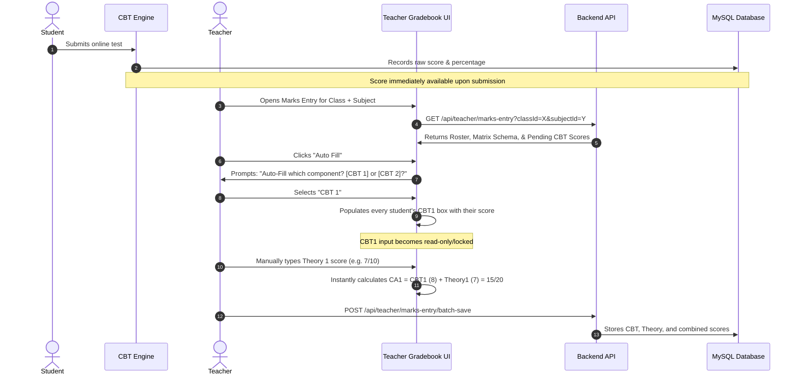
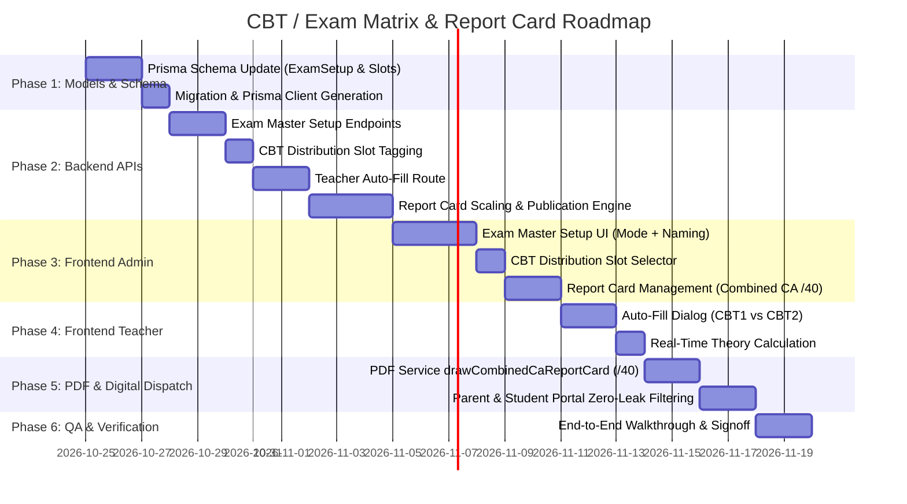

# CBT / Exam Matrix & Report Card System — Senior Fullstack Implementation Plan

**Prepared for:** Kingsley & Tech Engineering Team  
**Architecture Paradigm:** Multi-Tenant Node.js/Express (TypeScript) + Next.js App Router (React 19) + MySQL (Prisma ORM)  
**Status:** Architectural Blueprint & Implementation Guide (No Code Mutations)  
**Date:** October 2026  

---

## 1. Executive Summary & Architectural Gap Analysis

The Ugbekun 2.0 codebase already possesses foundational elements for Examination management, CBT distribution, and Evaluation Matrices (`EvaluationMatrix`, `EvaluationMatrixColumn`, `EvaluationMatrixItemMapping`, and `ClassReportCardPublication`). However, a deep forensic audit of the active codebase against the new **Functional Document** reveals several critical architectural and workflow misalignments that must be refactored.

### 1.1 Existing State vs. Functional Specification Audit

| Module / Requirement | Current Implementation in Codebase | Required State (Functional Document) | Architectural Gap / Action Required |
| :--- | :--- | :--- | :--- |
| **Exam Setup / Component Naming** | Fixed column keys (`CA1`, `CA2`, `EXAM`) in `EvaluationMatrixColumn` with hardcoded labels in `pdfService.ts` (`TEST (40)`, `EXAM (60)`). | **Admin controls 100% of naming** on report cards (e.g., "Continuous Assessment 1", "CA1", "Theory Assessment", etc.). | Replace hardcoded report headers with dynamic component labels and weightings defined by the admin during setup. |
| **School Modes (CBT vs. Non-CBT)** | Evaluation matrices assume a single monolithic structure or loose component mapping. | Must cleanly support two distinct operational models: <br>1. **CBT Mode:** (CA1 = CBT1 + Theory1, CA2 = CBT2 + Theory2, Exam = CBT_Exam + Theory_Exam). <br>2. **Non-CBT Mode:** (Pure CA / Theory scores only). | Enable toggleable operational mode per matrix/class. In Non-CBT mode, suppress all CBT dropdowns and auto-fill buttons. In CBT mode, require child component splits. |
| **CBT Distribution Binding** | `OnlineExam` is distributed to classes without a strict, structured link to specific assessment slots (CBT1 vs. CBT2). | Admin explicitly tags a distributed CBT to an Exam Master component (e.g., **CBT 1** or **CBT 2**). | Add `assessmentSlot` or `examMasterComponentId` to `OnlineExamDistribution` so submissions route unambiguously into the teacher's gradebook. |
| **Auto-Fill Scoring (Teacher Flow)** | Teacher marks entry (`teacher-matrix-marks-entry.tsx`) has a single `handleSyncAllCbtToExam` button that dumps scores into whatever component matches `/exam\|terminal\|cbt/i`. | 1. Teacher clicks **"Auto Fill"**. <br>2. System prompts: **"Fill CBT1 or CBT2?"** <br>3. Teacher selects slot. <br>4. System populates all students' scores for that slot and locks it, leaving Theory input open. | Implement modal dialog in Teacher Gradebook prompting slot selection (`CBT1` vs `CBT2`), fetch student attempts for that specific distribution, populate the exact target column, and compute combined CA immediately. |
| **Combined CA Report Card (Out of 40)** | `report-card-management.tsx` has binary stage tabs (`CA1`, `CA2`, `FULL`). When viewing mid-term slips, only single CAs are rendered. Full cards assume 100 marks total. | Admin can select **CA1 and CA2 simultaneously**. When combined, the system automatically sums them to a total **over 40 (NOT over 100)**, showing actual student score out of 40, class average out of 40, and percentage. | Implement multi-select CA generator (`CA1 + CA2`). Adjust mathematical scaling engine in `pdfService.ts` and API to compute base `40` instead of base `100`. |
| **Digital Dispatch & Data Isolation** | Binary publishing toggle with partial flags in `ClassReportCardPublication`. PDF service lacks strict column filtering on digital generation. | CA-only report cards can be sent digitally to parents/students. **Exam scores must strictly NEVER leak** into CA-only digital or printed slips. | Implement strict serialization filter in the Parent/Student API endpoint: if `reportType === 'CA_ONLY'`, strip all exam columns, exam grades, and rankings before response transmission or PDF compilation. |

---

## 2. Core Domain Model & Schema Evolution (Prisma)

To support dynamic naming, split CBT + Theory components, and combined CA out of 40, the relational model requires targeted enhancements.



### 2.1 Prisma Schema Modifications (Targeted & Backward-Compatible)

```prisma
// ==========================================
// 1. EXAM MASTER SETUP & COMPONENTS
// ==========================================
model ExamSetup {
  id              Int       @id @default(autoincrement())
  name            String    // e.g. "First Term 2026/2027 Assessments"
  termId          Int       @map("term_id")
  sessionId       Int       @map("session_id")
  branchId        Int       @map("branch_id")
  branch          Branch    @relation(fields: [branchId], references: [id])
  
  mode            String    @default("CBT_HYBRID") @map("mode") // "CBT_HYBRID" (CBT + Theory) | "MANUAL_ONLY"
  
  components      AssessmentComponent[]
  evaluationMatrix EvaluationMatrix?

  createdAt       DateTime  @default(now()) @map("created_at")
  updatedAt       DateTime? @updatedAt @map("updated_at")

  @@unique([branchId, sessionId, termId, name])
  @@map("exam_setups")
}

model AssessmentComponent {
  id              Int       @id @default(autoincrement())
  setupId         Int       @map("setup_id")
  setup           ExamSetup @relation(fields: [setupId], references: [id], onDelete: Cascade)
  
  code            String    @map("code")            // System key: "CA1", "CA2", "EXAM"
  displayName     String    @map("display_name")    // 100% Admin defined: e.g. "Continuous Assessment 1"
  maxMarks        Float     @map("max_marks")       // e.g. 20.0, 60.0
  displayOrder    Int       @default(1) @map("display_order")
  
  // Child breakdowns if CBT Mode is active
  hasCbt          Boolean   @default(false) @map("has_cbt")
  cbtMaxMarks     Float?    @map("cbt_max_marks")    // e.g. 10.0
  theoryMaxMarks  Float?    @map("theory_max_marks") // e.g. 10.0
  
  // Distributions linked to this specific component slot
  cbtDistributions OnlineExamDistribution[]
  
  @@unique([setupId, code])
  @@map("assessment_components")
}

// ==========================================
// 2. ENHANCED CBT DISTRIBUTION LINK
// ==========================================
// In existing model OnlineExamDistribution (schema.prisma):
// Add:
//   assessmentComponentId  Int?                  @map("assessment_component_id")
//   assessmentComponent    AssessmentComponent?  @relation(fields: [assessmentComponentId], references: [id])
//   targetSlot             String?               @map("target_slot") // "CBT1" | "CBT2" | "CBT_EXAM"

// ==========================================
// 3. STUDENT DETAILED COMPONENT SCORES
// ==========================================
model StudentComponentScore {
  id             Int       @id @default(autoincrement())
  studentId      Int       @map("student_id")
  subjectId      Int       @map("subject_id")
  classId        Int       @map("class_id")
  sectionId      Int       @map("section_id")
  sessionId      Int       @map("session_id")
  termId         Int       @map("term_id")
  branchId       Int       @map("branch_id")
  
  componentCode  String    @map("component_code") // "CA1", "CA2", "EXAM"
  cbtScore       Float?    @map("cbt_score")      // e.g. 8.5
  theoryScore    Float?    @map("theory_score")   // e.g. 9.0
  totalScore     Float     @map("total_score")    // e.g. 17.5
  
  isAbsent       Boolean   @default(false) @map("is_absent")
  enteredById    Int?      @map("entered_by_id")
  
  createdAt      DateTime  @default(now()) @map("created_at")
  updatedAt      DateTime? @updatedAt @map("updated_at")

  @@unique([studentId, subjectId, sessionId, termId, componentCode])
  @@index([classId, sectionId, subjectId])
  @@map("student_component_scores")
}

// ==========================================
// 4. REPORT CARD PUBLICATION & DISPATCH
// ==========================================
// In existing ClassReportCardPublication (schema.prisma:2519):
// Ensure the following fields govern parent & student access:
//   releaseCa1       Boolean @default(false)
//   releaseCa2       Boolean @default(false)
//   releaseCombinedCa Boolean @default(false) // Release CA1 + CA2 (out of 40)
//   releaseExam      Boolean @default(false)
//   releaseFull      Boolean @default(false)
```

---

## 3. Detailed Workflow & Engineering Specifications

### Workflow 1: Exam Master & Component Setup (Admin Desk)
```
Admin Dashboard -> Academics -> Exam Master Setup
  ├── Select Session & Term
  ├── Select School Mode:
  │    ├── [Mode A] CBT Hybrid (CBT + Theory)
  │    └── [Mode B] Manual / Non-CBT (Theory/CA Only)
  ├── Add Assessment Components:
  │    ├── Component 1:
  │    │    ├── Code: CA1
  │    │    ├── Report Card Display Title: [Input: e.g., "Continuous Assessment 1"]
  │    │    ├── Total Component Marks: [Admin configured: e.g. 20]
  │    │    └── (If CBT Mode) Dynamic Weight Split:
  │    │         ├── CBT Weight: [Admin configured: e.g., 15 or 10]
  │    │         └── Theory Weight: [Admin configured: e.g., 5 or 10]
  │    │         └── Validation: CBT Weight + Theory Weight === Total Component Marks
  │    ├── Component 2:
  │    │    ├── Code: CA2
  │    │    ├── Report Card Display Title: [Input: e.g., "Continuous Assessment 2"]
  │    │    ├── Total Component Marks: [Admin configured: e.g. 20]
  │    │    └── (If CBT Mode) Dynamic Weight Split:
  │    │         ├── CBT Weight: [Admin configured: e.g., 15 or 10]
  │    │         └── Theory Weight: [Admin configured: e.g., 5 or 10]
  │    └── Component 3 (Terminal):
  │         ├── Code: EXAM
  │         ├── Report Card Display Title: [Input: e.g., "Terminal Examination"]
  │         ├── Total Component Marks: [Admin configured: e.g. 60]
  │         └── (If CBT Mode) Dynamic Weight Split:
  │              ├── CBT Weight: [Admin configured: e.g., 20 or 30]
  │              └── Theory Weight: [Admin configured: e.g., 40 or 30]
  └── Save Exam Setup -> Automatically generates Evaluation Matrix
```

**Technical Rules:**
1. **100% Admin Configurable Weights:** Component weights are never hardcoded. The admin enters both the component total and the exact CBT vs. Theory split. The frontend and backend validate that `cbtMaxMarks + theoryMaxMarks === maxMarks`.
2. **Immutable Report Card Naming:** The admin input string for `displayName` is **the immutable single source of truth** for report cards, matrix tables, and teacher gradebook columns. The system must never hardcode "CA1" on user-facing outputs if the admin labeled it "First Assessment".

---

### Workflow 2: CBT Distribution & Slot Linking (Admin Desk)
1. Admin creates or selects an approved exam from the **Question Bank / CBT Studio**.
2. In the **Distribution Modal**:
   * Admin selects Target Class & Section(s).
   * System detects the Term's Exam Setup.
   * Admin chooses the **Target CBT Slot**:
     * `[Dropdown] Select Exam Component: ( ) CBT 1  |  ( ) CBT 2  |  ( ) Terminal CBT`
3. Upon saving:
   * The distribution is stored with `assessmentComponentId` and `targetSlot = 'CBT1'`.
   * When students take the test, their attempt scores are automatically indexed under this slot.

---

### Workflow 3: Student CBT Attempt & Auto-Fill (Teacher Gradebook Flow)



#### Step-by-Step UI/UX Specifications for Auto-Fill:
1. **Button Presence:** The "Auto Fill" button with a magic wand icon (`Wand2`) is visible on the Gradebook toolbar only when the school operates in CBT mode and students have completed tests.
2. **Interactive Modal Prompt:**
   * Modal Title: **"Auto-Fill CBT Marks into Gradebook"**
   * Subtitle: *"Select which assessment slot to populate for this subject."*
   * Options:
     * Radio Button 1: **CBT 1 (Linked to: Mid-Term Test 1 — 28 student scores found)**
     * Radio Button 2: **CBT 2 (Linked to: Mid-Term Test 2 — 30 student scores found)**
   * Action: `[Confirm & Populate]`
3. **Instant Population:**
   * The corresponding student sub-column (e.g., `CBT 1`) fills in milliseconds.
   * If a student missed the CBT, their box shows `0` or `-` (Absent).
   * Teacher is only left to enter the `Theory` column.
   * Total column updates in real-time on keystroke without server roundtrip.

---

### Workflow 4: Report Card Settings & Combined CA Engine (Admin Desk)

#### The Critical 40-Mark Rule:
When generating mid-term report cards, schools frequently evaluate students based strictly on Continuous Assessment (CA1 + CA2) without terminal exams.

$$\text{Combined CA Score} = \text{CA}_1 + \text{CA}_2$$

$$\text{Combined CA Maximum} = \text{Max}(\text{CA}_1) + \text{Max}(\text{CA}_2) = 20 + 20 = 40$$

$$\text{CA Percentage} = \left( \frac{\text{Combined CA Score}}{40} \right) \times 100$$

$$\text{Class Overall Average} = \frac{\sum_{i=1}^{N} \text{Student Combined CA}_i}{N} \quad (\text{displayed out of } 40 \text{ and } \%)$$

> [!IMPORTANT]
> **Strict Scaling Constraint:**  
> When the admin selects `CA1 + CA2`, the report card total header **MUST display `/40`**, NOT `/100`.  
> An English score of `CA1 = 15/20` and `CA2 = 15/20` must reflect as **`30 / 40 (75%)`**. The system must never divide by 100 or append `30 / 100`.

#### Admin Selection Interface (`ReportCardManagement`):
In `report-card-management.tsx`, replace the single-select dropdown with a multi-segment selector:

```
[ Assessment Scope: ]
  ( ) Full Term (CA1 + CA2 + Exam) — Out of 100
  (•) Combined CA Only (CA1 + CA2)  — Out of 40
  ( ) Single CA 1 Only             — Out of 20
  ( ) Single CA 2 Only             — Out of 20
```

---

### Workflow 5: Report Card Delivery & Zero-Leakage Security (Print & Digital)

#### Option A: Print CA-Only Report Card
* Admin or Teacher clicks **"Print / Batch PDF"** with *Combined CA Only* selected.
* The PDF engine triggers `drawCombinedCaReportCard()`:
  * Table Headers: `[Subject Code]`, `[Subject Name]`, `[CA 1 (weight)]`, `[CA 2 (weight)]`, `[TOTAL CA (combined max)]`, `[CLASS AVG]`, `[GRADE]`.
  * Exam column is **completely omitted from the table**.
  * Summary Banner: `Overall CA Performance: 32.5 / 40 (81.2%)`.
  * **Class Ranking & Promotion Scope Hidden:** Position in class (e.g., "1st of 32") and Batch Promotion Status are **strictly hidden** on CA-only progress reports. Rankings and promotion decisions are only computed and visible on the full Terminal Examination report card.
  * Summary footer shows Class Teacher & Principal signatures.

#### Option B: Digital Dispatch to Parent & Student Portals
* Admin opens **Publication Modal** in `ReportCardManagement`.
* Checkbox: `[x] Release Combined CA (CA1 + CA2) to Parent & Student Portals`.
* When Parent logs in (`parent-dashboard.tsx`) or Student logs in (`student-dashboard.tsx`):
  * The backend API `GET /api/parent/child/:id/report-card` inspects the publication mask.
  * If only `releaseCombinedCa = true` and `releaseFull = false`:
    * The backend **strips the `theoryMark` / `examScore` properties completely from the JSON payload**.
    * The backend **omits `rank` and `promotionStatus`** so ranking is never leaked or visible prematurely.
    * Even if a curious parent inspects the browser DevTools Network tab, the exam score and class ranking are not sent over the wire.
    * The parent UI only renders the CA Progress Card out of 40 with no ranking badge.

---

## 4. End-to-End API Specifications

### 4.1 Exam Master Setup
* **`POST /api/admin/academics/exam-setup`**
  ```json
  {
    "name": "First Term 2026/2027",
    "termId": 1,
    "sessionId": 4,
    "mode": "CBT_HYBRID",
    "components": [
      {
        "code": "CA1",
        "displayName": "Continuous Assessment 1",
        "maxMarks": 20,
        "hasCbt": true,
        "cbtMaxMarks": 10,
        "theoryMaxMarks": 10
      },
      {
        "code": "CA2",
        "displayName": "Continuous Assessment 2",
        "maxMarks": 20,
        "hasCbt": true,
        "cbtMaxMarks": 10,
        "theoryMaxMarks": 10
      },
      {
        "code": "EXAM",
        "displayName": "Terminal Examination",
        "maxMarks": 60,
        "hasCbt": true,
        "cbtMaxMarks": 30,
        "theoryMaxMarks": 30
      }
    ]
  }
  ```

### 4.2 Auto-Fill Query (Teacher Gradebook)
* **`GET /api/teacher/marks-entry/cbt-attempts?classId=12&sectionId=4&subjectId=8&slot=CBT1`**
  * **Response:**
    ```json
    {
      "success": true,
      "slot": "CBT1",
      "examTitle": "Grade 5 Basic Science CBT 1",
      "maxMarks": 10,
      "scores": [
        { "studentId": 101, "rawScore": 8.0, "isAbsent": false },
        { "studentId": 102, "rawScore": 9.5, "isAbsent": false },
        { "studentId": 103, "rawScore": null, "isAbsent": true }
      ]
    }
    ```

### 4.3 Report Card Generation Query
* **`GET /api/admin/reports/report-card?classId=12&sectionId=4&sessionId=4&termId=1&scope=COMBINED_CA`**
  * **Response:**
    ```json
    {
      "success": true,
      "scope": "COMBINED_CA",
      "maxTotal": 40,
      "classAverage": 29.4,
      "students": [
        {
          "studentId": 101,
          "name": "Eseosa Kingsley",
          "registerNo": "UGB/2026/042",
          "subjects": [
            {
              "subjectCode": "ENG",
              "subjectName": "English Language",
              "ca1": 15.0,
              "ca2": 15.0,
              "totalCa": 30.0,
              "maxCa": 40.0,
              "percentage": 75.0,
              "grade": "B",
              "classAvg": 28.5
            }
          ],
          "overallScore": 30.0,
          "overallMax": 40.0,
          "overallPercentage": 75.0
        }
      ]
    }
    ```

---

## 5. Phased Implementation Roadmap



### Phase 1: Database Schema & Migration
1. Add `ExamSetup` and `AssessmentComponent` models to `prisma/schema.prisma`.
2. Add `targetSlot` (`CBT1` | `CBT2` | `CBT_EXAM`) to `OnlineExamDistribution`.
3. Add `releaseCombinedCa` boolean to `ClassReportCardPublication`.
4. Run `npx prisma migrate dev` (or `npx prisma db push`).

### Phase 2: Backend Services & API Routes
1. Create `controllers/admin/adminExamSetupController.ts` supporting full custom naming.
2. Update `controllers/admin/adminExamCbtController.ts` to store and validate target CBT slot on distribution.
3. Implement `GET /api/teacher/marks-entry/cbt-attempts` to provide clean roster-indexed scores for auto-fill.
4. Update `controllers/admin/adminMarksReportController.ts` with `COMBINED_CA` scope calculations.

### Phase 3: Teacher Gradebook Refactor
1. In `teacher-matrix-marks-entry.tsx`, replace the ambiguous single sync button with the **"Auto Fill" modal**.
2. Prompt teacher to pick `CBT 1` or `CBT 2`.
3. Auto-populate selected CBT boxes and compute `CA = CBT + Theory` in real time.

### Phase 4: Admin Report Card & PDF Engine Refactor
1. In `report-card-management.tsx`, add the **"Combined CA Only (Out of 40)"** option.
2. In `lib/pdfService.ts`, implement `drawCombinedCaReportCard`:
   * Render dynamic admin-defined column titles.
   * Render scores over 40.
   * Exclude exam columns completely.
3. In `lib/parentAcademicsController.ts`, enforce zero-leakage stripping of unreleased exam data.

---

## 6. Verification & Quality Acceptance Checklist

| # | Test Scenario | Expected Outcome | Pass/Fail Gate |
| :--- | :--- | :--- | :--- |
| **T1** | Admin sets custom title: `"First Half CA Assessment"` for `CA1`. | Report card table header and teacher gradebook show exact string `"First Half CA Assessment"`. | **Strict String Match** |
| **T2** | School in **Non-CBT Mode** opens marks entry. | "Auto Fill" button is hidden. No CBT columns are rendered; teacher only inputs CA/Theory scores. | **Zero CBT UI in Non-CBT Mode** |
| **T3** | Student completes CBT 1 (Score: 8/10). Teacher clicks "Auto Fill" -> selects "CBT 1". | Student's CBT1 box populates with `8.0`. Box becomes locked. Teacher enters Theory `7.0`. Total updates to `15.0/20.0`. | **Zero Manual Entry for CBT** |
| **T4** | Admin selects **Combined CA (CA1 + CA2)** report card for student with `CA1 = 15/20` and `CA2 = 15/20`. | Report card renders total as **`30 / 40`** and percentage as **`75%`**. Header reads `/40`, NOT `/100`. | **Mathematical Base 40 Integrity** |
| **T5** | Admin issues **CA-Only Digital Release** to Parent Portal. | Parent logs in. Terminal Exam column is completely absent from DOM and Network JSON payload. | **Zero Data Leakage** |
| **T6** | Admin configures custom component weight: `CBT = 15.0`, `Theory = 5.0` (Total `20.0`). | Teacher Gradebook validates maximum marks dynamically. CBT auto-fill cap is 15.0, Theory input max is 5.0. | **Dynamic Admin Weighting** |
| **T7** | Admin/Teacher prints or digitally sends Combined CA Report Card. | Class rank (position) and Batch Promotion Status are strictly suppressed/hidden. Only shown on Terminal Exam report cards. | **Ranking Hidden Until Terminal Exam** |

---
*End of Functional Implementation Blueprint.*
